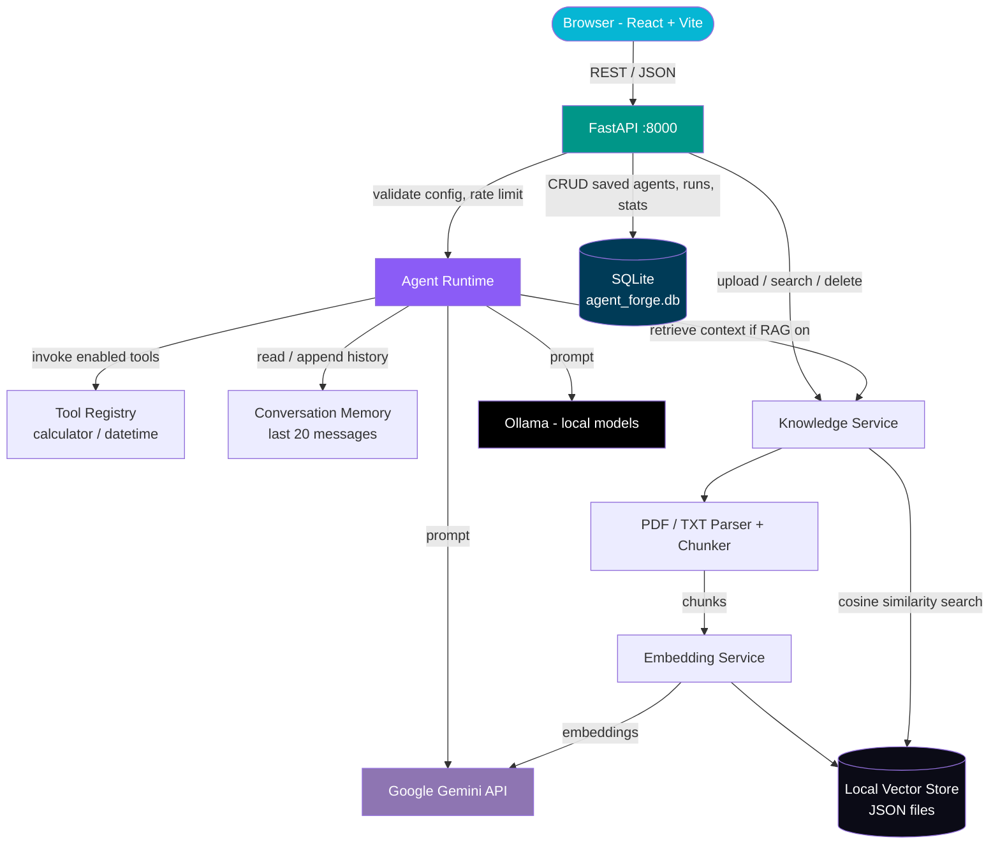

# 🤖 AgentForge — Learn, Build & Run Your First AI Agent

A full-stack platform that teaches beginners how AI agents work and lets them build one step by step. A React frontend guides users through lessons, a hardware advisor, and an 8-step agent builder, while a FastAPI backend runs the agents with tool execution, conversation memory, and document-based knowledge retrieval (RAG).


---

## ✨ Features

- **Guided agent builder** – An 8-step wizard (Identity → Personality → Brain → Tools → Memory → Knowledge → Language → Review) that produces a validated agent configuration and a downloadable starter project in Python or JavaScript.
- **Agent runtime API** – `POST /api/agent/run` takes a strictly validated config (Pydantic, unknown fields rejected) and runs the agent against **Google Gemini** or a **local Ollama** model.
- **Safe tool execution** – A small tool registry with a `calculator` (AST-based arithmetic evaluator, no `eval`) and a `datetime` tool. Tools that aren't implemented are explicitly reported as unavailable instead of being simulated.
- **Conversation memory** – Provider-neutral, per-conversation history, bounded to the last 20 messages and switchable per agent (`none` / `buffer`).
- **Document knowledge (RAG)** – Upload `.txt` / `.pdf` files (10 MB limit), which are parsed, chunked with overlap, embedded with Gemini, and stored in a local vector store. Agents retrieve relevant chunks by cosine similarity and return **source citations** (file, page, score).
- **Saved agents (CRUD)** – Create, list, update (PATCH), and delete agent configurations, persisted in SQLite.
- **Execution history & analytics** – Every run is logged with provider, model, duration, success/error type, and tools used, with paginated history and aggregate stats.
- **Demo rate limiting** – Eight Gemini requests per server-observed client IP in a sliding 30-minute window, recorded atomically in the existing SQLite database.
- **Learning content** – 10 interactive lessons, a hardware advisor that recommends local models for a device's RAM/VRAM/storage, a local-vs-API comparison, and a curated resources page.
- **Dark / light theme** – Dark-first UI with a full light theme and animated explainers (see [`DESIGN.md`](./DESIGN.md)).

---

## 🏗️ Architecture



**How it flows:**

1. The React app calls the FastAPI backend (CORS is enabled for the Vite dev server on ports 5173/5174).
2. `POST /api/agent/run` validates the request body against `AgentConfig`, applies the Gemini rate limit using the connection's client IP, and creates a run record in SQLite.
3. The `Agent` sends fixed application policy as a provider system instruction and places agent settings, conversation history, user input, tool status, and retrieved knowledge in the user content.
4. If RAG is enabled, the question is embedded and matched against the local vector store. Only chunks above a relevance threshold are added to the prompt, and their sources are returned in the response.
5. The prompt is sent to Gemini or Ollama, the exchange is appended to memory, and the run's duration, tools used, and outcome are written back to SQLite.
6. Errors are mapped to clear HTTP statuses (`400` invalid request, `429` rate limited, `502` provider unavailable).

---

## 🛠️ Tech Stack

| Layer                | Technology                                      |
|----------------------|--------------------------------------------------|
| Backend framework    | FastAPI + Uvicorn                               |
| Validation           | Pydantic v2                                     |
| Database             | SQLite (runs, tool logs, saved agents)          |
| LLM providers        | Google Gemini (`google-genai`), Ollama (local)  |
| Embeddings           | Gemini `gemini-embedding-001`                   |
| Vector search        | NumPy cosine similarity over a local JSON store |
| Document parsing     | pypdf, plain-text decoding                      |
| Frontend             | React 19 + TypeScript + React Router            |
| Styling & motion     | Tailwind CSS 4, Framer Motion                   |
| Build tool           | Vite 7                                          |
| Config management    | python-dotenv (`backend/.env`)                  |

---

## 🔌 API Overview

Interactive docs are available at `http://127.0.0.1:8000/docs` once the backend is running.

| Method   | Endpoint                        | Description                                         |
|----------|----------------------------------|-----------------------------------------------------|
| `GET`    | `/health`                       | Health check                                        |
| `POST`   | `/api/agent/run`                | Run an agent with a config and a message            |
| `GET`    | `/api/agent/tools`              | List available tools                                |
| `GET`    | `/api/agent/stats`              | Aggregate run statistics                            |
| `GET`    | `/api/agent/runs`               | Paginated execution history (`limit`, `offset`)     |
| `GET`    | `/api/agent/runs/{id}`          | Details for a single run                            |
| `POST`   | `/api/agents`                   | Save an agent configuration                         |
| `GET`    | `/api/agents`                   | List saved agents                                   |
| `GET`    | `/api/agents/{id}`              | Get one saved agent                                 |
| `PATCH`  | `/api/agents/{id}`              | Partially update a saved agent                      |
| `DELETE` | `/api/agents/{id}`              | Delete a saved agent                                |
| `POST`   | `/api/knowledge/upload`         | Upload and index a `.txt` / `.pdf` document         |
| `GET`    | `/api/knowledge/documents`      | List indexed documents                              |
| `POST`   | `/api/knowledge/search`         | Semantic search over indexed documents              |
| `DELETE` | `/api/knowledge/documents/{id}` | Remove a document and its vectors                   |
| `GET`    | `/api/knowledge/status`         | Vector store status                                 |

**Example request**

```json
POST /api/agent/run
{
  "message": "What is 12 * (3 + 4)?",
  "config": {
    "name": "Clockwise",
    "purpose": "Answer math and time questions",
    "personality": "concise and friendly",
    "provider": "gemini",
    "model": "gemini-3.6-flash",
    "agentType": "general",
    "tools": ["calculator", "datetime"],
    "memory": "buffer",
    "knowledge": "none",
    "outputStyle": "concise"
  }
}
```

---

## 📁 Project Structure

```text
AGENT_FORGE/
├── backend/
│   ├── app/
│   │   ├── main.py                 # FastAPI app, CORS, error handling, lifespan
│   │   ├── agents/agent.py         # Agent runtime and prompt builder
│   │   ├── api/                    # Routers: agent, saved agents, knowledge
│   │   ├── models/                 # Pydantic models (AgentConfig, requests)
│   │   └── services/               # db, tools, memory, rate_limit, knowledge,
│   │                               # chunker, document_parser, embedding_service,
│   │                               # vector_store, gemini_service, ollama_service
│   ├── test_*.py                   # Backend tests
│   ├── requirements.txt
│   └── .env.example
├── src/
│   ├── pages/                      # Home, Learn, Lesson, Builder, MyAgents, ...
│   ├── components/                 # Layout, diagrams, UI kit, motion helpers
│   ├── data/                       # Lessons, models, hardware advisor, codegen
│   └── utils/api.ts                # Typed API client
├── DESIGN.md                       # Design system reference
├── package.json
└── vite.config.ts
```

---

## 🚀 Run Locally / Getting Started

### Prerequisites

- Python 3.11+
- Node.js 20+
- A free [Gemini API key](https://aistudio.google.com/apikey) (required for Gemini and for document embeddings)
- *(Optional)* [Ollama](https://ollama.com) for running local models

### 1. Clone the repository

```bash
git clone https://github.com/aman-matoliya-dev/AGENT_FORGE.git
cd AGENT_FORGE
```

### 2. Create the backend `.env` file

```bash
cp backend/.env.example backend/.env
```

```env
# --- Google Gemini ---
GEMINI_API_KEY=your-gemini-api-key
GEMINI_EMBEDDING_MODEL=gemini-embedding-001

# --- Ollama (optional, for local models) ---
OLLAMA_BASE_URL=http://127.0.0.1:11434
OLLAMA_MODEL=llama3.2:latest
```

### 3. Start the backend

```bash
cd backend
python -m venv venv
source venv/bin/activate        # Windows: venv\Scripts\activate
pip install -r requirements.txt
uvicorn app.main:app --reload --port 8000
```

### 4. Start the frontend

In a second terminal, from the project root:

```bash
npm install
npm run dev
```

For a production build, set `VITE_API_BASE_URL` to the backend's absolute HTTP(S) URL. Production builds fail if this value is missing or malformed; the localhost default is development-only. Configure the backend with `APP_ENV=production` and `CORS_ORIGINS` as a comma-separated list of exact frontend origins. Production does not fall back to development CORS origins.

### 5. Access the application

| View          | URL                            |
|---------------|--------------------------------|
| Frontend      | `http://localhost:5173`        |
| API root      | `http://127.0.0.1:8000`        |
| Swagger docs  | `http://127.0.0.1:8000/docs`   |

### 6. (Optional) Use a local model with Ollama

```bash
ollama pull llama3.2
```

Then choose **Ollama** as the provider when building an agent.

### 7. Run the tests

```bash
cd backend
python -m unittest discover -p "test*.py"
```

---

## 📓 Notes

- The frontend calls `http://127.0.0.1:8000` only in development. Set `VITE_API_BASE_URL` at production build time.
- SQLite data lives in `backend/agent_forge.db`, and the knowledge store lives in `backend/data/knowledge/`. Both are git-ignored. Gemini quota events retain client IPs until expired events are pruned by a later Gemini request.
- The Gemini demo quota is per observed client IP. It does not authenticate users and can be bypassed by distributed clients or changing networks. Multiple workers must use the same SQLite file; multi-host deployments need a shared rate-limit service.
- Retrieved text and profile settings are sent as provider user content, separate from fixed system instructions. This reduces direct instruction override but does not eliminate prompt injection.
- Conversation memory is held in process memory, so it resets when the server restarts.
- Only Gemini (`gemini-3.6-flash`) and Ollama are supported providers. Notes, web search, and persistent memory are not implemented yet and are reported as unavailable rather than faked.
- Knowledge retrieval supports text-based PDFs and `.txt` files; OCR for scanned PDFs is not implemented.
- Never commit `backend/.env` or real API keys.

---

<p align="center">
  Built by <a href="https://github.com/aman-matoliya-dev">aman-matoliya-dev</a>
</p>
