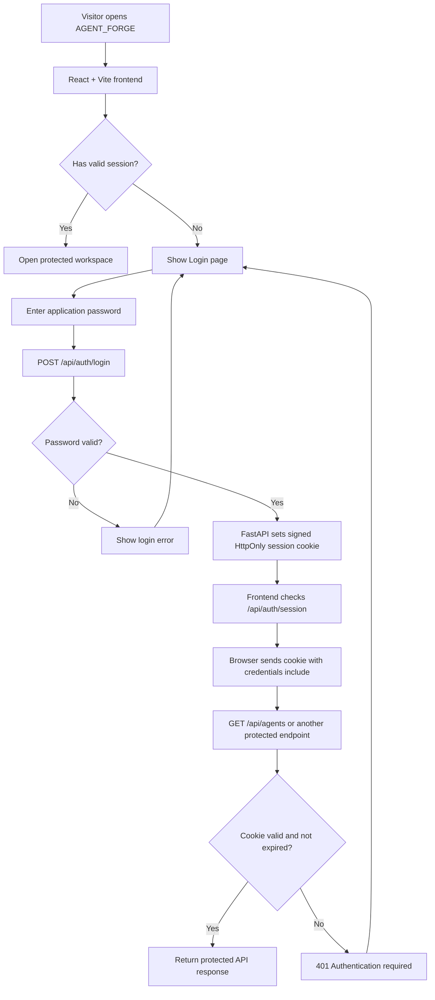
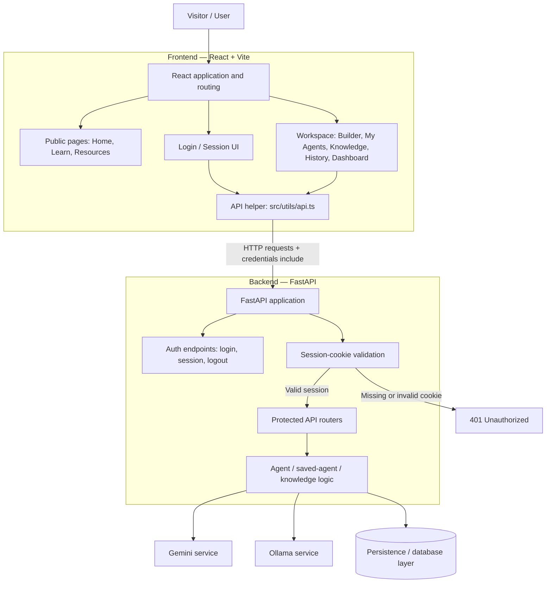
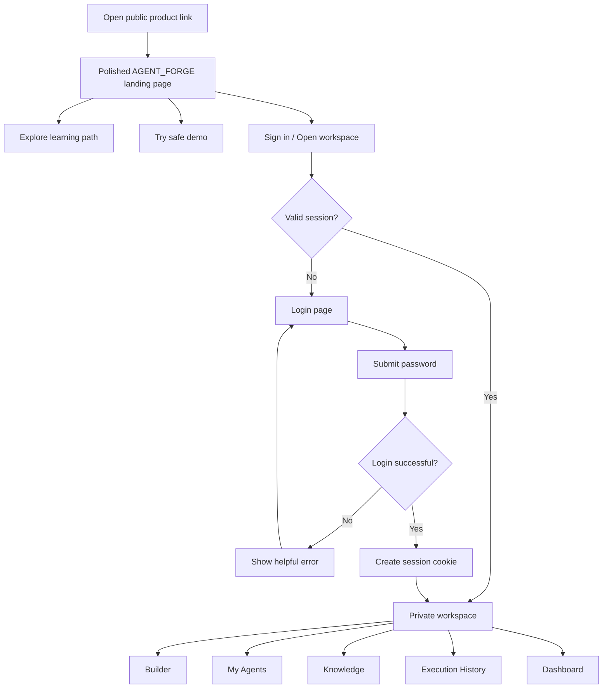
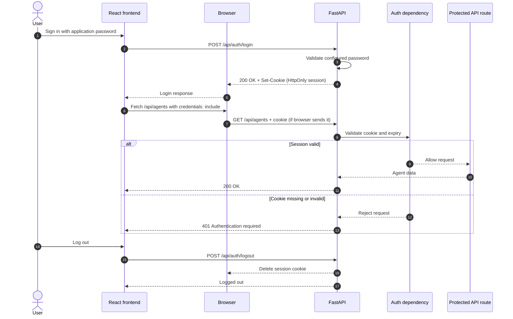
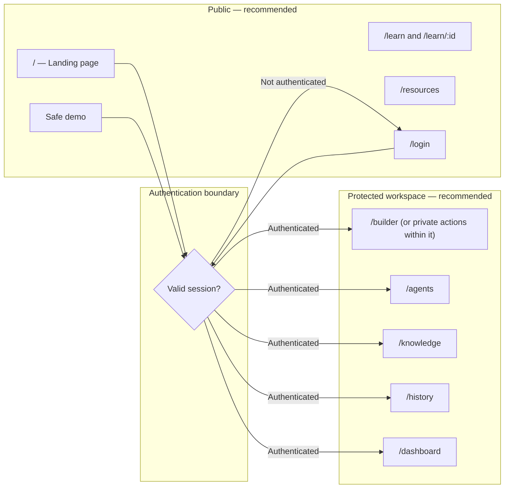
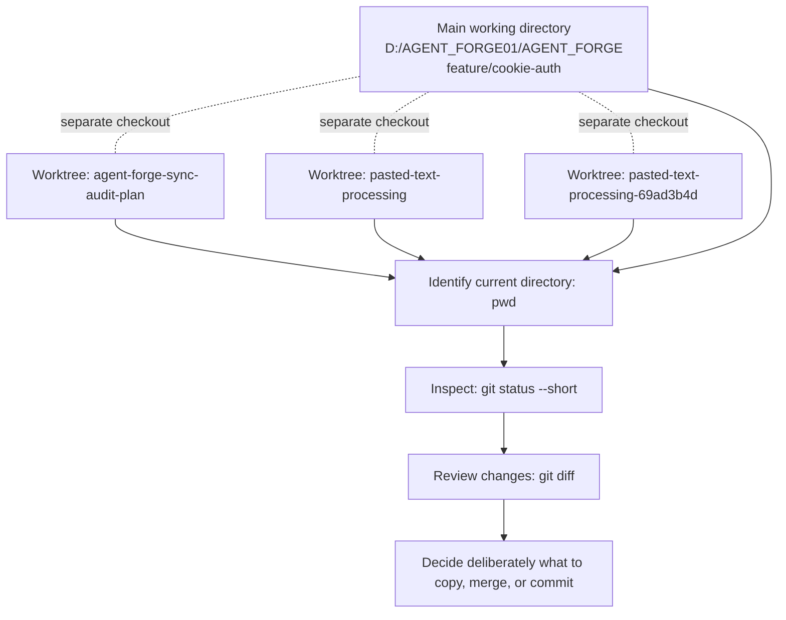
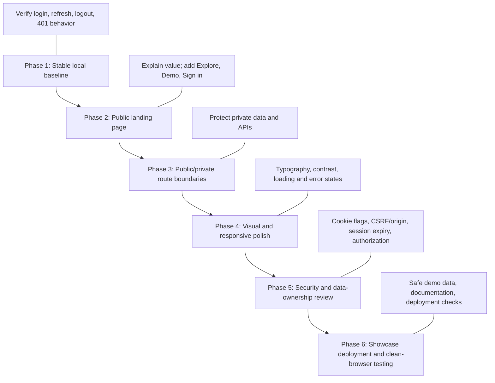
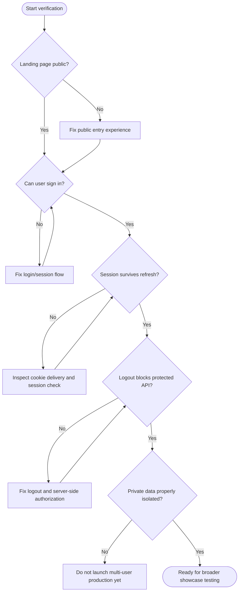

# AGENT_FORGE — Mermaid Architecture & Project Flow

> Consolidated Mermaid source for the AGENT_FORGE diagrams discussed in our conversation. These diagrams distinguish the current authentication setup from proposed improvements. Verify exact route behavior and persistence against the current source before treating every detail as implemented.

## 1. Current authentication flow

## 2. High-level application architecture

## 3. Recommended public-to-workspace journey

> Proposal: visitors should understand what the product does before being asked to sign in. Public pages can remain accessible while private workspace actions require authentication.

## 4. Protected API request and cookie validation

## 5. Route boundaries (recommended access policy)

> This is a proposed product policy, not a claim that these exact route guards are all implemented now.

## 6. Git worktrees and safe change flow

A change made in one worktree does not automatically appear in another worktree's working files. Preserve uncommitted modifications and backup/patch files.

## 7. Development-to-showcase roadmap

## 8. Pre-showcase verification checklist

## Architecture notes

- Frontend: React + Vite, using `HashRouter` in the inspected `src/App.tsx`.
- API helper: `src/utils/api.ts`, with `credentials: "include"` in the discussed request helpers.
- Authentication routes: `backend/app/api/auth_routes.py`.
- Session validation: `backend/app/services/auth.py`.
- FastAPI app, CORS/origin checks, and protected router registration: `backend/app/main.py`.
- The current authentication design uses one configured application password. This can be suitable for a controlled demonstration, but it is not a complete multi-user account system and does not by itself provide per-user ownership or isolation.
- Before production, verify protected API/data paths, cookie settings, CSRF/origin protections, password management, and logout/session behavior.
